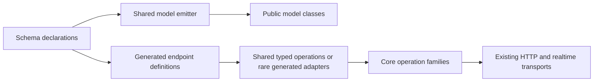

# Public models and shared client operations

Status: implemented in `dart_http_core` 0.4.1 and
`dart_http_server_codegen` 0.6.0. The design examples below illustrate the API;
see the package README for the concrete migration instructions.

## Direction

Generate public model classes directly. Keep the current callable endpoint API,
including `.start`, `.info`, and response streaming. Move endpoint definitions
and execution behavior into reusable classes in `dart_http_core`. Use predefined
operation classes for common argument signatures; generate small adapters only
for signatures the core does not yet cover.

Keep model generation and client execution as separate changes. Public models
do not require changing the operation API.



## Evidence from Dicto

The current generated client contains 104 operation classes and 7,037 binding
lines. An HTTP operation repeats its client field, metadata getter, invocation
assembly, and start/abort forwarding. Binary operations also repeat a streaming
invocation. The client getter constructs a wrapper on every access.

The 100 HTTP endpoints have only six argument/response shapes:

| Count | Shape |
| --- | --- |
| 86 | JSON response, required body |
| 7 | JSON response, no payload arguments |
| 3 | JSON response, required multipart body and optional upload progress |
| 2 | Binary response, optional query |
| 1 | Binary response, required body |
| 1 | JSON response, optional query |

The remaining operations are three query-based WebSocket connections and one
WebTransport connection without payload arguments. Eight shared concrete classes
could therefore cover all 104 current operations without endpoint-specific
classes. This is a signature analysis, not an implemented size or speed benchmark.

The model builder currently accepts an annotated typedef, derives the public
name from it, and emits a private backing class:

```dart
@FromHttpSchema(dashboardPanelSchema)
typedef DashboardPanel = _$DashboardPanel;
```

The separate client model emitter already emits public classes and can reuse
external models through `externalSchemaIds` and `schemaTypes`. It has a separate
implementation of field mapping and serialization from the contract builder.

## 1. Public model declarations

Introduce a model-generation annotation on the schema constant itself. For
example:

```dart
@GenerateHttpModel(name: 'DashboardPanel')
const dashboardPanelSchema = JsonSchema.object(
  id: 'DashboardPanel',
  properties: {
    'id': JsonSchema.string(),
    'title': JsonSchema.string(),
  },
  required: ['id', 'title'],
  additionalProperties: false,
);
```

The existing part builder emits the public class into the same library:

```dart
final class DashboardPanel implements JsonEncodable {
  const DashboardPanel({required this.id, required this.title});

  // Existing factories and schema/HTTP helpers remain available.
  final String id;
  final String title;
}
```

There is no typedef and no private implementation class. Consumer code can use:

```dart
DashboardPanel panel() => .new(id: 'overview', title: 'Overview');
```

The annotation carries model configuration such as registry, reference bindings,
response status, and JSON versus multipart input. The model name is explicit;
do not infer public Dart names from arbitrary schema IDs or URLs.

Preserve the current model contract: constructor requiredness, nullable fields,
JSON field names, named scalar types, referenced models, union handling,
`decode`, `fromJson`, `toJson`, `schemaId`, `schema`, and HTTP helpers where
applicable. Keep multipart encoding and query decoding available. Do not add
equality or copy APIs as an incidental part of this migration.

Keep the existing typedef annotations supported during migration. Generic model
declarations need explicit type-parameter and bound metadata because a constant
cannot declare Dart type parameters; retain the existing generic mode until that
metadata is supported and covered by equivalent tests. Never silently erase a
generic parameter or turn it into `dynamic`.

Use one schema-to-model representation and emitter for contract and client
models. Portable field/type/JSON mapping belongs in the shared JSON schema
codegen owner; HTTP codegen contributes response, query, and multipart adapters.
Start by separating those responsibilities behind a common representation,
rather than moving HTTP concerns into a portable schema package.

Reuse models by schema identity and explicit bindings. Do not merge unrelated
request/response schemas solely because their fields happen to match. Detect
duplicate public names and conflicting schema definitions during generation.

## 2. Shared operations in dart_http_core

Separate three things:

1. An immutable **endpoint definition**: operation identity, method/path,
   request codecs, expected response codec/status, and documented errors.
2. A client-bound **operation**: reusable execution behavior for that definition.
3. A **request handle**: one started execution, with cancellation and lifecycle.

The existing `DartHttpClientOperationInfo`, `DartHttpClientRequestHandle`,
`startDartHttpClientRequest`, `invoke`, and `invokeStream` remain the foundation.
Do not add a second HTTP transport or a competing cancellation mechanism.

Suggested operation families:

| Core family | Capabilities exposed by generated adapter |
| --- | --- |
| `DartHttpJsonOperation` | Callable buffered response, `.start`, `.info` |
| `DartHttpBinaryOperation` | Callable buffered bytes, `.start`, `.info`, `.stream` |
| `DartHttpSseOperation` | Callable streaming response, `.start`, `.info`; retain current raw SSE behavior initially |
| `DartHttpWebSocketOperation` | `.connect`, `.info` |
| `DartHttpWebTransportOperation` | `.connect`, `.info` |

Response capability determines the operation family. JSON, multipart, and raw
request bodies are independent codec choices. A multipart upload may return
JSON or binary data; it must not require a separate operation hierarchy for
every response combination. Expose upload progress on adapters for upload
operations only.

Use typed endpoint definitions compatible with the existing five invocation
types: response, path parameters, query, headers, and body. Put stable metadata
and codecs in one generated definition per endpoint. Only actual argument
values and execution options are assembled for each request. Definitions may
be `const` where supported, otherwise immutable `final` values.

### Consumer API stays familiar

```dart
final response = await client.adminV1AdminQueryDashboard(
  body: .new(dashboard: 'usage'),
);

final request = client.adminV1AdminQueryDashboard.start(
  body: .new(dashboard: 'usage'),
);
final info = client.adminV1AdminQueryDashboard.info;
request.cancel();

final download = await client.downloadRecording.stream(params: recordingParams);
```

The request body fields and endpoint names here are illustrative. Keep existing
names and parameter contracts in the first migration; route grouping can be a
separate change.

### Predefined classes for the actual signatures

Provide these concrete types on top of shared execution behavior:

| Shared core type | Typed endpoint arguments |
| --- | --- |
| `DartHttpJsonBodyOperation<TBody, TResponse>` | Required `body` |
| `DartHttpJsonOperation<TResponse>` | No payload arguments |
| `DartHttpMultipartJsonBodyOperation<TBody, TResponse>` | Required `body`, optional `onUploadProgress` |
| `DartHttpBinaryQueryOperation<TQuery>` | Optional `query` |
| `DartHttpBinaryBodyOperation<TBody>` | Required `body` |
| `DartHttpJsonQueryOperation<TQuery, TResponse>` | Optional `query` |
| `DartHttpWebSocketQueryOperation<TQuery>` | Optional `query` and `protocols` |
| `DartHttpWebTransportOperation` | No payload arguments |

HTTP classes keep `abortTrigger` and `timeout` on direct calls, and `timeout` on
`.start`, as today. Binary classes also expose `.stream` with the same payload
arguments. JSON classes do not expose an irrelevant streaming member. Keep
required bodies required rather than using nullable generic parameters to make
one universal class accept every shape.

For example, the first core class has real generic methods:

```dart
// Signature sketch, not a complete implementation.
Future<DartHttpClientResponseObject<TResponse>> call({
  required TBody body,
  Future<void>? abortTrigger,
  Duration? timeout,
});

DartHttpClientRequestHandle<DartHttpClientResponseObject<TResponse>> start({
  required TBody body,
  Duration? timeout,
});
```

The generated client binds that class to an endpoint definition and concrete
types. It emits no `AdminQueryDashboardOperation` class. Contextual `.new` for a
public body model still works through the concrete generic receiver; this was
verified with a compiler probe using a shared callable generic class.

Multipart's concrete wrapper exists to expose the progress argument. It reuses
JSON response execution and a multipart body codec, rather than duplicating that
execution implementation.

### Fallback for unusual signatures

Dart cannot forward an arbitrary function type's named parameters through a
generic `call` method. A function field named `call` also does not make its
container callable; this was verified with the current Dart compiler.

An endpoint with `required body` and optional `query` needs a different signature
from one with `required params` and no body. A generic core object cannot expose
all these signatures exactly without generated methods or a different input API.

For an uncommon combination, generate a thin typed adapter using core execution
behavior. It supplies only the applicable `.call`, `.start`, `.stream`, or
`.connect` signatures and forwards arguments. Add a new predefined core shape
when it is useful across endpoints or consumers. Do not eagerly implement every
combination of params, query, headers, body, upload progress, and response mode.

This hybrid keeps ordinary Dicto calls unchanged and removes its current 104
endpoint classes, without requiring records at call sites or a large matrix of
unused core classes. Measure generated source reduction after a prototype before
claiming a percentage, build-time improvement, or runtime benefit.

Generated operation classes are currently public. Replacing their types and
constructors affects consumers that explicitly name or instantiate them, even
though normal `client.endpoint(...)` calls stay unchanged. Offer a legacy
generation mode during migration and review this public API change before
choosing the release version. A typedef alone cannot preserve an old constructor
that implicitly selected an endpoint definition.

## 3. Behavioral guarantees

- `.info` is stable endpoint metadata and starts no request.
- Each `.call`, `.start`, `.stream`, or `.connect` creates an independent
  execution. Operations do not retain mutable per-request state.
- `.start` returns the existing typed handle and preserves timeout/error behavior.
- Buffered success means response decoding has completed. Opening a stream does
  not mean its body has been consumed; document that distinction for streaming
  handles rather than silently changing their state semantics.
- Cancellation remains connected to transport work and streamed-body ownership.
  Do not release cancellation/timeout ownership merely because headers arrive.
- Keep documented HTTP errors distinct from transport/decoding exceptions.
- Preserve multipart upload progress, abort triggers, default headers, path/query
  encoding, and binary/SSE streaming ownership.

## 4. Delivery and validation

1. Add public model declarations while retaining legacy annotations. Test
   serialization equivalence and compile a consumer in another library using
   `.new`, `.decode`, and named constructors. Cover required/optional fields,
   references, nullable unions, named scalars, and multipart/query helpers.
2. Migrate Dicto's model declaration sources and regenerate through the existing
   build scripts. Check public exports, server handlers, client code, and both
   Flutter applications. Generated files are never edited manually.
3. Extract endpoint definitions and core operation families. Select the eight
   shared shapes for Dicto and retain exact call signatures. Generate fixtures
   for JSON, binary, SSE, multipart, WebSocket, and WebTransport.
4. Verify compile-time argument requirements and runtime parity: encoding,
   decoding, documented errors, exceptions, simultaneous requests, cancellation,
   timeouts, upload progress, streaming disposal, and metadata consistency.
5. Regenerate Dicto and compare generated line counts, public API changes,
   analyzer diagnostics, and tests. Publish core before codegen, then update
   consumers. Keep the current analyzer-cleanup release separate from this work.
