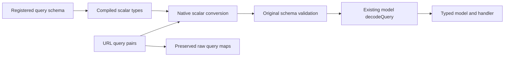

# Schema aware query parameter conversion

Status: native runtime implementation complete; package publication pending.

Convert URL query values according to the registered route schema before native
validation. Keep the existing model `decodeQuery` method and route callback API.
A declared integer accepts `?offset=0`, while malformed values and values outside
the schema's bounds remain validation errors.

## Failure and correction

Callo's messages request serialized an integer offset into the URL as `offset=0`.
The native server validated `{"offset":"0"}` against an integer property and
returned `422` before the Dart decoder ran. Callo's decoder already parsed the
string correctly; changing or renaming that decoder would not fix the native
rejection.

The runtime now compiles scalar query type information from the installed schema
registry when registering routes. For each request, it converts a temporary
validation object and checks the original JSON Schema against that object. The
original query pairs continue through the existing native boundary to Dart.



## Application API

Keep the schema and model fields typed as integers. Use the existing generated
decoder to construct the Dart model:

```dart
RouteOptions(
  query: MessageListQuery.schemaRef,
  queryDecoder: MessageListQuery.decodeQuery,
);
```

`decodeQuery` continues to receive `Map<String, String>` and uses the existing
`decodeSchemaQueryValues` helper. `fromJson` and `toJson` retain JSON integer
values. The HTTP client continues serializing those values into URL text.

This change adds no model constructor, annotation source, typed callback option,
FFI function, or manifest field. Registered query codecs and callbacks retain
their existing Dart-side input behavior. Applications still choose a suitable
query decoder, rather than passing an integer JSON decoder raw URL strings.

## Conversion rules

| Condition | Native validation behavior |
| --- | --- |
| Integer property | Parse a signed 64-bit decimal integer without an intermediate floating-point conversion. Leading zeros, an optional plus, and surrounding whitespace are accepted by the parser. Overflow and fractional syntax remain strings and fail the integer schema. |
| Number property | Parse a JSON number; non-finite values and overflow remain strings and fail the number schema. |
| Boolean property | Convert only `true` and `false`. |
| String property | Preserve text exactly, including numeric-looking IDs such as `00042`. |
| Missing property | Leave it absent; schema validation checks required fields and model decoding owns defaults. |
| Nullable scalar | Convert using the one declared scalar type. Literal `null` stays a string; it does not become JSON null. |
| Repeated scalar key | Use the last value for validation, matching `queryMap`. Preserve every value in `queryAllMap`. |
| Unknown key | Preserve its string value; let the original schema enforce `additionalProperties`. |
| Unsupported or ambiguous type | Preserve string validation; do not guess array, object, or union encodings. |

Resolve local component references, aliases, and supported registry references
while compiling query types. Support nullable scalar type arrays and
unambiguous scalar `anyOf`/`oneOf` branches. Collect properties from root `allOf`
declarations. Reference traversal is bounded and detects cycles.

Conversion does not replace the validator: bounds, enums, required fields, and
unknown-property rules still come from the original schema. Malformed scalar
syntax stays a string, so the existing validator rejects it with the normal
`422` response. Custom Dart decoder failures retain their existing `400` path.

## Ownership and scope

The implementation lives in
[`query_schema.rs`](../packages/dart_http_server_runtime/rust/src/query_schema.rs)
and the query-validation call sites in
[`lib.rs`](../packages/dart_http_server_runtime/rust/src/lib.rs).
Compiled routes share the conversion metadata with request matches through an
`Arc`; references are not resolved on the request path.

HTTP requests and WebSocket handshakes use this conversion. The native
WebTransport validation path also uses it if query metadata is present; current
Dart WebTransport manifests do not declare a query schema.

JSON body, path parameter, and header validation are unchanged. Inline schemas
retain the framework's existing behavior: only an explicit schema reference
selects a registry validation target. No additional query serialization formats
or Dart/codegen API changes are part of this implementation.

The Rust crate is bumped to `0.1.37` so native artifacts and build caches select
the updated implementation. The native ABI remains `27`.

## Verification

Rust tests cover scalar conversion, root/property aliases, nullable fields,
reference cycles, unsupported shapes, invalid syntax, overflow, and validation
of the converted object against the original constraints. One regression test
demonstrates that the validator rejects raw `{"offset":"0"}` and accepts the
converted integer object.

The real native HTTP/WebSocket regression suite covers the existing
`decodeQuery` helper, typed values reaching handlers, omitted offset defaults,
raw strings and repeated values, component references, required fields, bounds,
invalid values, enums, unknown properties, and unchanged JSON body validation:
[`query_schema_conversion_test.dart`](../packages/dart_http_server_runtime/test/query_schema_conversion_test.dart).

Run the repository checks before publication:

```sh
dart run melos run ci
cargo test --locked --manifest-path packages/dart_http_server_runtime/rust/Cargo.toml
cargo test --locked --manifest-path packages/dart_http_native_client/rust/Cargo.toml
```

## Publication and Callo adoption

Publish a runtime package release with matching `0.1.37` native artifacts before
updating consumers. Review app-facing server dependency bounds so consumers
select the corrected runtime. Keep codegen and the `decodeQuery` API unchanged.

Then update Callo's hosted runtime dependency, restore `MessagingQuery.offset`
to an integer JSON value and an integer schema with bounds `0..100000`, and
retain its real HTTP regression test. Existing published apps send the same URL
values and remain wire-compatible. Callo server `0.5.12` keeps its working string
workaround until that dependency update and server deployment are complete.
